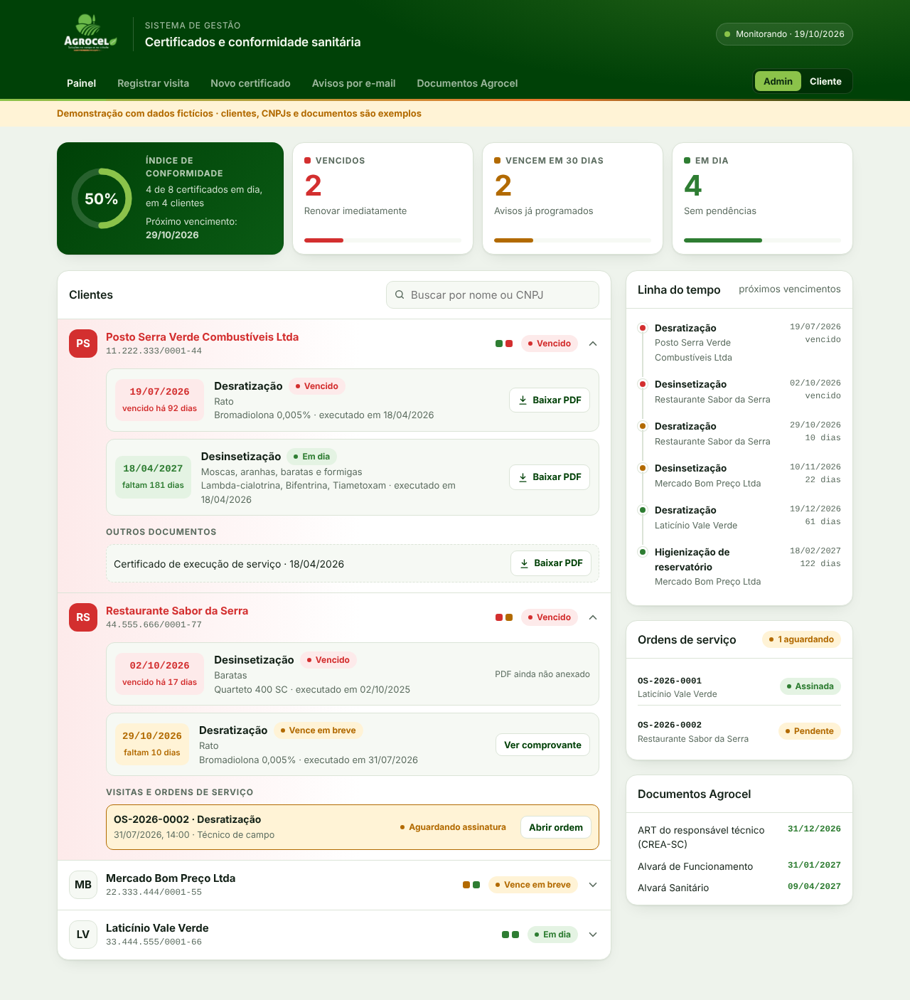
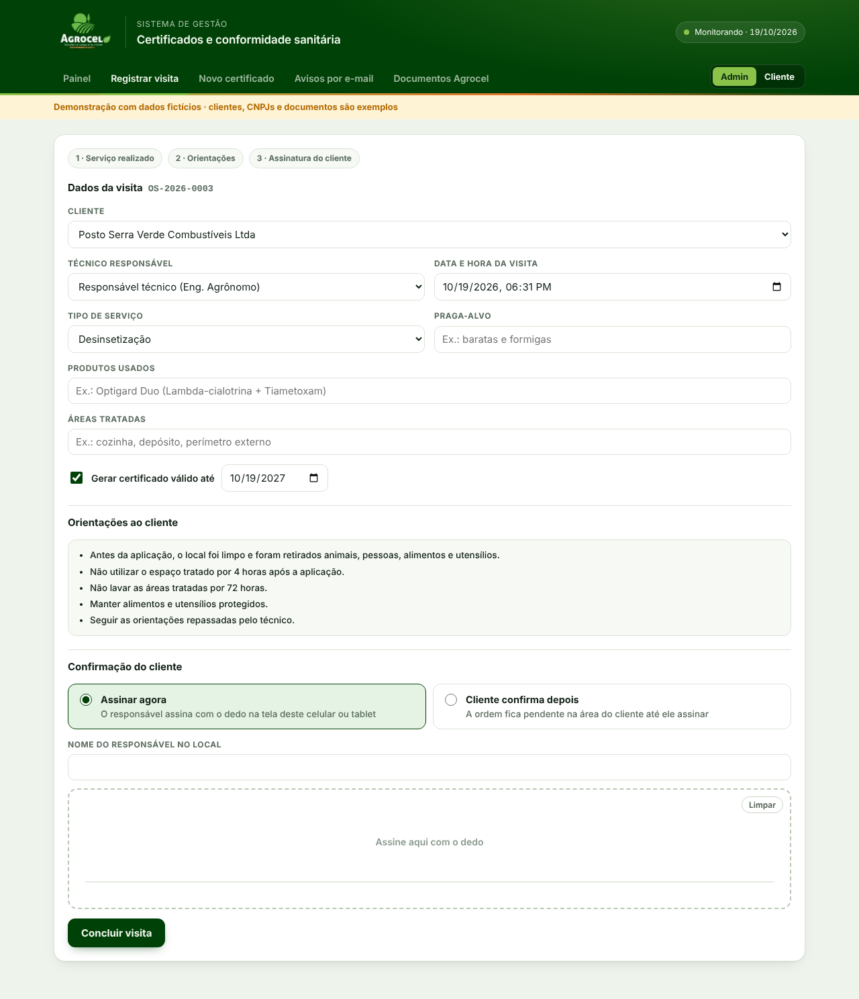
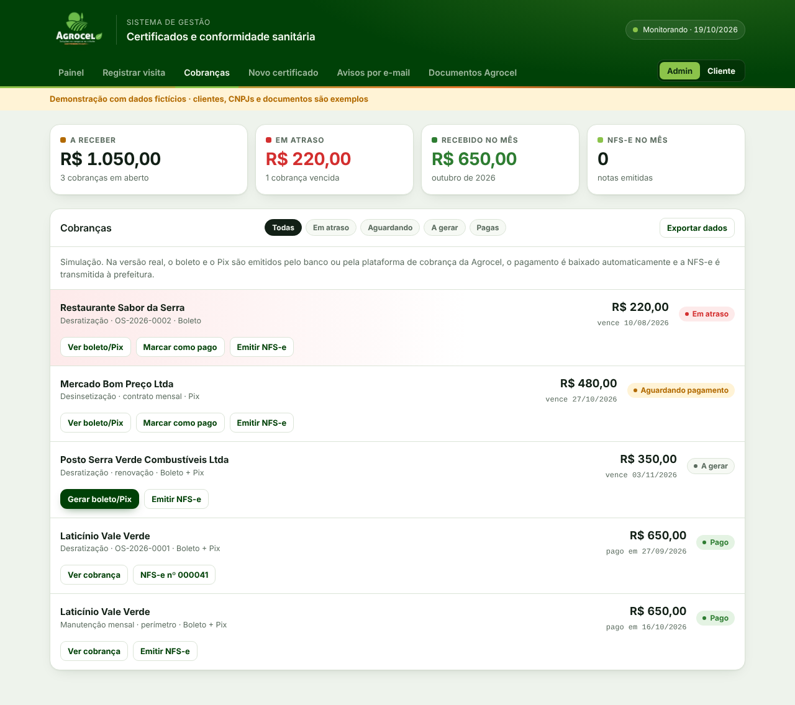
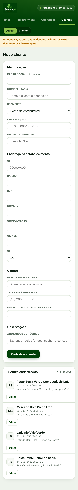

# Agrocel Certificados

Sistema de gestão de certificados de controle de pragas da **Agrocel – Soluções no campo e na cidade** (Rio Fortuna/SC).

O app acompanha a validade de cada certificado emitido (desinsetização, desratização, higienização de reservatórios), avisa antes do vencimento e dá a cada cliente acesso aos próprios laudos.









> **Os dados ficam no banco (Supabase), não neste repositório.** As capturas de tela abaixo usam dados fictícios. Boleto, Pix e NFS-e continuam sendo simulação.

## Login e perfis

O acesso é feito com e-mail e senha. Existem três perfis:

| Perfil | O que pode fazer |
|---|---|
| **Cliente** | Ver apenas os próprios certificados, ordens de serviço, fotos, relatórios e cobranças; assinar ordens pendentes |
| **Técnico** | Cadastrar clientes e criar o acesso deles, registrar visitas e laudos com relatório e fotos, emitir certificados com PDF |
| **Administrador** | Acesso total: cobranças, NFS-e, exportação, avisos, documentos da empresa e cadastro de técnicos, administradores e clientes (aba **Usuários**) |

Primeiro acesso: na tela de login, use **Primeiro acesso do sistema** para criar o administrador. Isso só funciona enquanto não existe nenhum administrador. Depois, o administrador cadastra os demais usuários com uma senha provisória, e cada pessoa troca a senha em **Minha conta**.

## Funcionalidades

**Painel administrativo**
- Índice de conformidade com a porcentagem de certificados em dia
- Contadores de vencidos, que vencem em 30 dias e em dia, que também funcionam como filtros
- Lista de clientes com busca por nome ou CNPJ; clientes com pendência aparecem em vermelho no topo
- Linha do tempo com os próximos vencimentos
- Controle dos documentos da própria empresa (ART, alvarás)

**Cores de status**

| Status | Regra |
|---|---|
| 🔴 Vencido | data de validade já passou |
| 🟡 Vence em breve | vence nos próximos 30 dias |
| 🟢 Em dia | vence em mais de 30 dias |

**Cadastro de clientes**
- Ficha completa: razão social, nome fantasia, segmento, CNPJ e inscrição municipal
- Endereço com CEP, rua, número, complemento, bairro, cidade e UF
- Contato: responsável no local, telefone/WhatsApp e e-mail que recebe os avisos
- Anotações do técnico (acesso ao local, horários, cuidados)
- Máscara automática de CNPJ, CEP e telefone, com validação dos dígitos do CNPJ e aviso de CNPJ repetido
- Edição da ficha pelo painel ou pela lista de clientes

**Cadastro de certificados**
- Validade sugerida pelo tipo de serviço: desinsetização 12 meses, desratização 3 meses, higienização de reservatório 6 meses
- Anexo do PDF assinado

**Registro de visita técnica (ordem de serviço)**
- O técnico registra no local: cliente, data e hora, serviço, praga-alvo, produtos e áreas tratadas
- Cada visita gera uma ordem de serviço numerada (OS-2026-0001, OS-2026-0002…)
- Orientações pós-aplicação e termo de compromisso exibidos ao cliente
- Opção de gerar o certificado com a validade já calculada

**Assinatura do cliente na tela**
- Substitui o termo de compromisso em papel
- O responsável assina com o dedo no celular ou tablet do técnico, ou confirma depois na própria área do cliente
- O comprovante registra nome, data, hora e um código de verificação

**Cobranças (boleto e Pix)** · *simulação*
- Valor e forma de pagamento definidos ao registrar a visita
- Geração de boleto (linha digitável) e Pix (QR Code e copia e cola)
- Situação de cada cobrança: a gerar, aguardando pagamento, em atraso ou pago
- Totais a receber, em atraso e recebidos no mês

**NFS-e** · *simulação*
- Emissão a partir da cobrança, com serviço do item 7.13 da LC 116/2003
- Cálculo do ISS pela alíquota informada
- Nota com prestador, tomador, valores e código de verificação

**Impressão e PDF**
- NFS-e, cobrança e ordem de serviço saem em PDF com o logo, o rodapé da empresa e a assinatura do cliente
- Botão de imprimir quando o navegador permite

**Exportação de dados**
- Planilha Excel com uma aba para empresas, certificados, visitas, cobranças e notas fiscais
- CSV das empresas, pronto para abrir no Excel
- Backup completo em JSON

**Avisos por e-mail**
- Dois avisos por certificado: 30 e 15 dias antes do vencimento
- Enviados ao responsável técnico e ao cliente

**Área do cliente**
- Cada cliente vê apenas os próprios certificados, com status e data de validade
- Download dos PDFs assinados

## Como rodar

É uma página estática que conversa com o Supabase (login, banco e arquivos). Sirva a pasta com qualquer servidor estático (por exemplo `npx http-server -p 8765`) e abra `http://127.0.0.1:8765/index.html`, ou publique pelo GitHub Pages (*Settings → Pages → Deploy from branch → main / root*).

O app usa a chave pública (anon) do projeto, que pode ficar no código; a proteção dos dados é feita pelas regras de acesso do banco.

## Estrutura

```
index.html                 app completo (HTML, CSS e JavaScript)
assets/logo-agrocel.png    logomarca
assets/exemplos/           certificados de exemplo em PDF
docs/painel.png            captura de tela
```

## Próximos passos

- [x] Login real para administradores, técnicos e clientes
- [x] Banco de dados (Supabase)
- [ ] E-mail de convite e de recuperação de senha
- [ ] Envio automático dos e-mails de aviso
- [ ] Avisos por WhatsApp
- [ ] Integração real de boleto/Pix com o banco ou plataforma de cobrança
- [ ] Emissão real de NFS-e (prefeitura ou API de notas)
- [ ] Geração do certificado e da ordem de serviço em PDF direto pelo app
- [ ] Versão para várias empresas de controle de pragas

## Autor

Desenvolvido por **Thiago Pinho Pinheiro** para a Agrocel.
