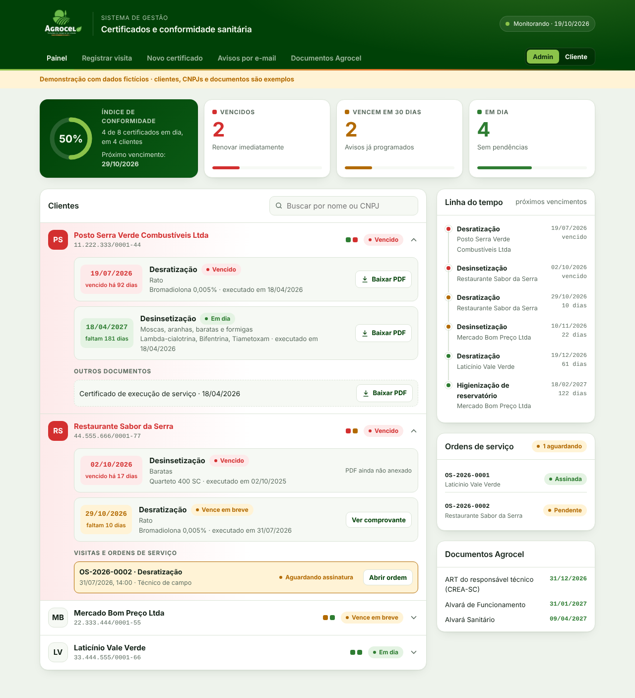
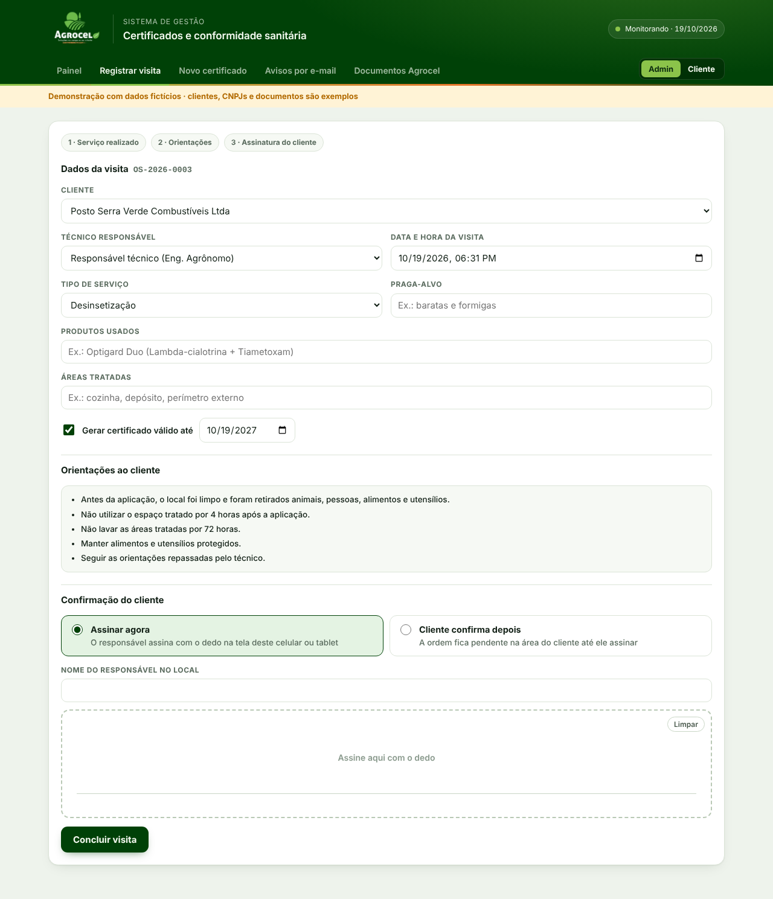
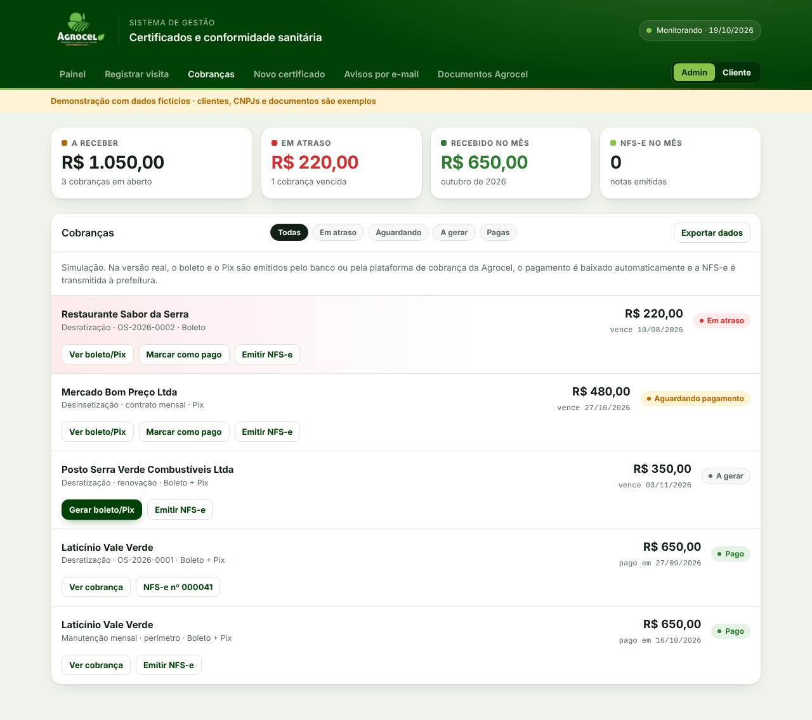
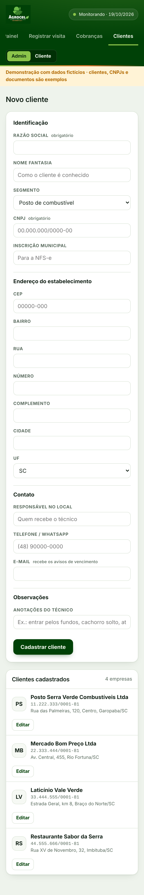

# Agrocel Certificados

Sistema de gestão de certificados de controle de pragas da **Agrocel – Soluções no campo e na cidade** (Rio Fortuna/SC).

O app acompanha a validade de cada certificado emitido (desinsetização, desratização, higienização de reservatórios), avisa antes do vencimento e dá a cada cliente acesso aos próprios laudos.









> **Os dados ficam no banco (Supabase), não neste repositório.** As capturas de tela abaixo usam dados fictícios.

## Visita técnica sem internet

- **Fotos:** dá para tirar uma de cada vez ou escolher várias; elas se acumulam na tela, com miniatura e botão para remover.
- **Sem conexão:** o app abre sem internet (service worker `sw.js` + bibliotecas em `assets/vendor`) e a visita, com relatório, fotos e assinatura, é guardada no celular (IndexedDB). Quando a internet volta, o envio é automático; a aba **Pendentes** mostra a fila, com Enviar agora e Descartar.
- O número da OS é definido no envio. A lista de clientes usada offline fica guardada só em aparelhos de técnico e administrador e é apagada ao sair da conta.
- Existe um teste de ponta a ponta dessa fila, que corta a internet do navegador de verdade. Ele fica fora do repositório público, junto com os demais scripts de teste.

## Política de privacidade e termo de uso

A tela de login tem links para a **Política de privacidade** e o **Termo de uso**, e quem já entrou encontra o botão **Privacidade** no cabeçalho. O texto descreve os dados tratados, a finalidade, os direitos do titular e as regras de uso. É um texto-base: peça a revisão de um advogado e confirme o e-mail de contato.

## Registro de atividade e exclusão de dados

- **Aba Registros (administrador):** mostra quem fez o quê e quando (entradas no sistema, cadastros, alterações, assinaturas e exclusões), com busca e filtro. O botão **Baixar registros.txt** salva tudo em um arquivo de texto. Ninguém consegue apagar nem alterar esse registro, e ele nunca guarda senhas nem e-mails.
- **Exclusão definitiva (administrador):** botões **Excluir** em cliente, certificado, ordem de serviço, cobrança e usuário. Excluir um cliente apaga também tudo o que é dele (certificados, ordens, fotos, cobranças, PDFs e os acessos dele), depois de digitar EXCLUIR. O técnico só consegue excluir fotos.

## Rotina de segurança

A rotina de verificação (semanal, mensal, trimestral, antes de mudanças e o que fazer em cada situação) e os testes de acesso por perfil ficam fora do repositório público, de propósito, e são guardados localmente pelo responsável. Na parte técnica, o que está aqui:

- `supabase/verificar-projetos.sql` compara as regras do banco real com as do teste.

## Ambiente de teste

Para experimentar sem risco, abra o app com `?teste` no final do endereço (por exemplo `https://thiagopinheirorj.github.io/AGROCELL/?teste`). Ele usa um banco separado, com clientes, certificados, visitas e cobranças **fictícios**, e mostra uma faixa laranja "Ambiente de teste". Nada feito ali vai para o sistema real.

O script que restaura o ambiente de teste ao estado inicial também fica fora do repositório público.

## Login e perfis

O acesso é feito com e-mail e senha. Existem três perfis:

| Perfil | O que pode fazer |
|---|---|
| **Cliente** | Ver apenas os próprios certificados, ordens de serviço, fotos, relatórios e cobranças; assinar ordens pendentes |
| **Técnico** | Cadastrar clientes e criar o acesso deles, agendar e registrar visitas e laudos com relatório e fotos, montar a rota do dia, acompanhar os leads (CRM de prospecção), emitir certificados com PDF (inclusive escaneando o documento pela câmera) |
| **Administrador** | Acesso total: cobranças, relatórios, exportação, avisos, documentos da empresa e cadastro de técnicos, administradores e clientes (aba **Usuários**) |

Primeiro acesso: na tela de login, use **Primeiro acesso do sistema** para criar o administrador. Isso só funciona enquanto não existe nenhum administrador. Depois, o administrador cadastra os demais usuários com uma senha provisória, e cada pessoa troca a senha em **Minha conta**.

## Funcionalidades

**Painel administrativo**
- Índice de conformidade com a porcentagem de certificados em dia
- Contadores de vencidos, que vencem em 30 dias e em dia, que também funcionam como filtros
- Lista de clientes com busca por nome ou CNPJ; clientes com pendência aparecem em vermelho no topo
- Linha do tempo com os próximos vencimentos
- Topo compacto e quadro **Pendências de visita** (visitas agendadas dos próximos 7 dias e atrasadas, ordens sem assinatura e visitas salvas no celular)
- Controle dos documentos da própria empresa (ART, alvarás)

**Cores de status**

| Status | Regra |
|---|---|
| 🔴 Vencido | data de validade já passou |
| 🟡 Vence em breve | vence nos próximos 30 dias |
| 🟢 Em dia | vence em mais de 30 dias |

**Cadastro de clientes**
- Ficha completa: razão social, nome fantasia, segmento, CPF ou CNPJ (opcional), inscrição estadual e inscrição municipal
- Endereço com CEP, rua, número, complemento, bairro, cidade e UF
- Contato: responsável no local, telefone/WhatsApp e e-mail que recebe os avisos
- Anotações do técnico (acesso ao local, horários, cuidados)
- Máscara automática de CPF/CNPJ, CEP e telefone, com validação dos dígitos (quando preenchido) e aviso de documento repetido
- Edição da ficha pelo painel ou pela lista de clientes

**Cadastro de certificados**
- Validade sugerida pelo tipo de serviço: desinsetização 12 meses, desratização 3 meses, higienização de reservatório 6 meses
- Anexo do PDF assinado, ou **escaneando o documento pela câmera**: uma foto por página, com melhora de leitura (fundo branco e texto escuro), girar e remover páginas; o app junta tudo em um PDF (até 12 páginas, 10 MB)

**Agenda de visitas** (administrador e técnico)
- Marca visita futura com cliente, dia, hora, serviço, técnico e observação; lista por dia (próximas, hoje, 7 dias, realizadas e canceladas)
- Remarcar, cancelar, reabrir e avisar o cliente pelo WhatsApp
- **Registrar visita** abre a ordem de serviço já com cliente e serviço; ao enviar a OS, o agendamento vira "realizado"
- Sugere clientes com certificado vencido ou perto de vencer, sem visita marcada

**Rota do dia** (administrador e técnico)
- Escolhe o técnico e o dia, monta as paradas com endereço e contato, muda a ordem, abre o mapa e gera o PDF para enviar
- Sugere as visitas agendadas para o dia

**Leads (CRM de prospecção, administrador e técnico)**
- Resumo com quentes, mornos, frios e retornos para hoje ou atrasados; potencial em negociação (serviço e contrato mensal)
- Ficha do lead: empresa e contato, termômetro de 5 itens (define quente, morno ou frio, com ajuste manual), etapas (Novo até Fechado ou Perdido), próximo passo com data e histórico de anotações
- **Cadastrar como cliente** leva o lead fechado para o cadastro de clientes

**Registro de visita técnica (ordem de serviço)**
- O técnico registra no local: cliente, data e hora, serviço, praga-alvo, produtos e áreas tratadas
- Cada visita gera uma ordem de serviço numerada (OS-2026-0001, OS-2026-0002…)
- Orientações pós-aplicação e termo de compromisso exibidos ao cliente
- Opção de gerar o certificado com a validade já calculada

**Assinatura do cliente na tela**
- Substitui o termo de compromisso em papel
- O responsável assina com o dedo no celular ou tablet do técnico, ou confirma depois na própria área do cliente
- O comprovante registra nome, data, hora e um código de verificação

**Cobranças (controle do que há a receber)**
- Valor, vencimento e forma de pagamento (Pix, boleto, dinheiro, cartão, transferência) definidos ao registrar a visita
- Situação de cada cobrança: aguardando pagamento, em atraso ou pago; botão "Marcar como pago"
- Totais a receber, em atraso e recebidos no mês
- Boleto, Pix e nota fiscal são emitidos fora do app (banco e sistema da prefeitura)

**Impressão e PDF**
- Cobrança e ordem de serviço saem em PDF com o logo, o rodapé da empresa e a assinatura do cliente
- Botão de imprimir quando o navegador permite

**Exportação de dados**
- Planilha Excel com uma aba para empresas, certificados, visitas, cobranças e notas fiscais
- CSV das empresas, pronto para abrir no Excel
- Backup completo em JSON

**Avisos de vencimento**
- Dois avisos por certificado: 30 e 15 dias antes do vencimento
- Destinatários previstos: o responsável técnico e o cliente
- A aba **Avisos por e-mail** mostra os avisos previstos para os próximos 90 dias. Por enquanto eles aparecem só na tela: o envio automático ainda não está ativo

**Área do cliente**
- Cada cliente vê apenas os próprios certificados, com status e data de validade
- Download dos PDFs assinados

## Como rodar

É uma página estática que conversa com o Supabase (login, banco e arquivos). Sirva a pasta com qualquer servidor estático (por exemplo `npx http-server -p 8765`) e abra `http://127.0.0.1:8765/index.html`, ou publique pelo GitHub Pages (*Settings → Pages → Deploy from branch → main / root*).

O app usa a chave pública (anon) do projeto, que pode ficar no código; a proteção dos dados é feita pelas regras de acesso do banco.

## Onde os dados ficam: nuvem ou servidor da empresa

O mesmo app funciona de dois jeitos. Por padrão os dados ficam na **nuvem** (Supabase, São Paulo). Quem preferir guardar tudo **no servidor da própria empresa** usa a pasta `instalador/`: um script para Windows (`instalar.ps1`, com Docker Desktop) ou Linux (`instalar.sh`) sobe o banco, o login, os arquivos e o app em um computador da empresa, aplica as mesmas regras de acesso e agenda um backup diário (banco + fotos e PDFs), com cópia opcional para uma pasta de nuvem como OneDrive ou Google Drive. O arquivo `config.js` diz ao app onde gravar (vazio = nuvem); a tela de entrada mostra "Os dados deste sistema ficam …". Detalhes em [instalador/README.md](instalador/README.md).

## Estrutura

```
index.html                 app completo (HTML, CSS e JavaScript)
config.js                  onde os dados ficam (vazio = nuvem; o instalador grava o servidor próprio)
sw.js                      cópia do app no aparelho (offline)
supabase/                  esquema do banco, migrações e função de usuários
instalador/                instalação no servidor da empresa (Docker) e backup
assets/logo-agrocel.png    logomarca
assets/exemplos/           certificados de exemplo em PDF
docs/painel.png            captura de tela
```

## Próximos passos

- [x] Login real para administradores, técnicos e clientes
- [x] Banco de dados (Supabase)
- [ ] E-mail de convite e de recuperação de senha
- [ ] Envio automático dos e-mails de aviso
- [ ] Avisos por WhatsApp
- [ ] Integração de boleto/Pix com o banco ou plataforma de cobrança (opcional, futuro)
- [ ] Emissão de NFS-e por API de notas (opcional, futuro)
- [ ] Geração do certificado e da ordem de serviço em PDF direto pelo app
- [x] Instalação no servidor da própria empresa (pasta instalador/)
- [ ] Versão para várias empresas de controle de pragas

## Autor

Desenvolvido por **Thiago Pinho Pinheiro** para a Agrocel.
